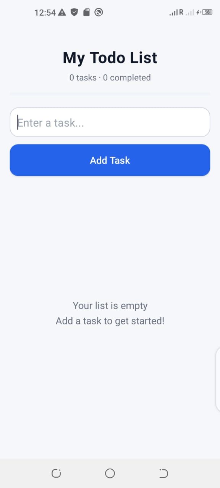

📝 To-Do List App

A modern and user-friendly Android To-Do List application built using Kotlin and XML in Android Studio.

✨ Features

Add new tasks

Edit existing tasks

Delete tasks

Mark tasks as completed

Strike-through completed tasks

Track total and completed tasks

View task completion progress

Save tasks using SharedPreferences

Restore tasks when reopening the app

Clean and modern user interface

🛠️ Technologies Used

Kotlin

XML Layouts

Android Studio

SharedPreferences

Git and GitHub

🚀 Getting Started

Clone or download this repository.

Open the project in Android Studio.

Allow Gradle to sync.

Run the app on an Android emulator or Android device.

🎯 Project Goal

This project demonstrates Android application development, UI design, task management, and local data persistence.

👨‍💻 Developer

Syed Wajid Ali Bukhari

GitHub: bukhariwajid78-rgb

Thank you for visiting this project!
## 📱 App Screenshot

