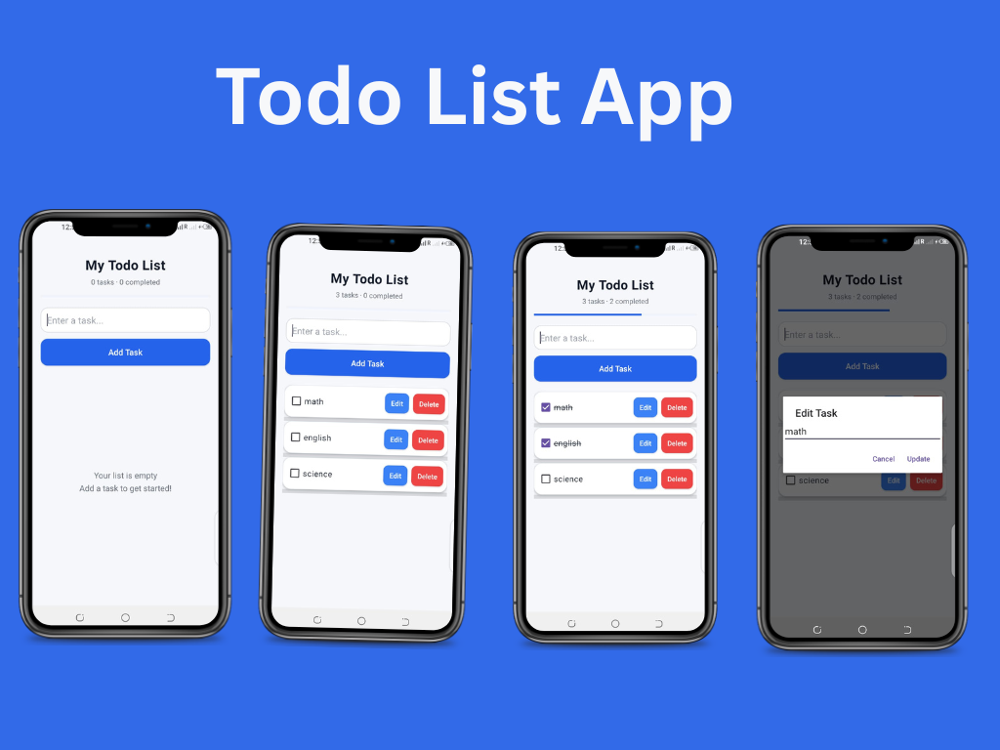

# 📝 To-Do List App

A modern Android To-Do List app built with Kotlin and XML, now using a **Room database** to save tasks.

📺 **Watch the video:** Room Database in Android (Kotlin) | Upgrading My To-Do App from SharedPreferences  https://youtu.be/Y7-qb96gyVU

## ✨ Features
- Add, edit and delete tasks
- Mark tasks as completed (with strike-through)
- Track total and completed tasks with a progress bar
- Tasks saved in a **Room database**, still there after the app is closed
- Screen updates automatically when data changes (Kotlin **Flow**)

## 🛠️ Technologies Used
- Kotlin + XML layouts
- **Room** (Entity, DAO, Database) with KSP
- Kotlin Coroutines and Flow
- Android Studio, Git and GitHub

## 🗂️ Versions
- **Current:** Room database (this branch)
- **Previous:** SharedPreferences, see the [`sharedpreferences-version`](../../tree/sharedpreferences-version) tag

## 🚀 Getting Started
1. Clone or download this repository.
2. Open the project in Android Studio.
3. Let Gradle sync.
4. Run the app on an emulator or Android device.

## 📱 App Screenshot

## 👨‍💻 Developer
**Syed Wajid Ali Bukhari** · YouTube: Bukhari Codes · GitHub: [bukhariwajid78-rgb](https://github.com/bukhariwajid78-rgb)
